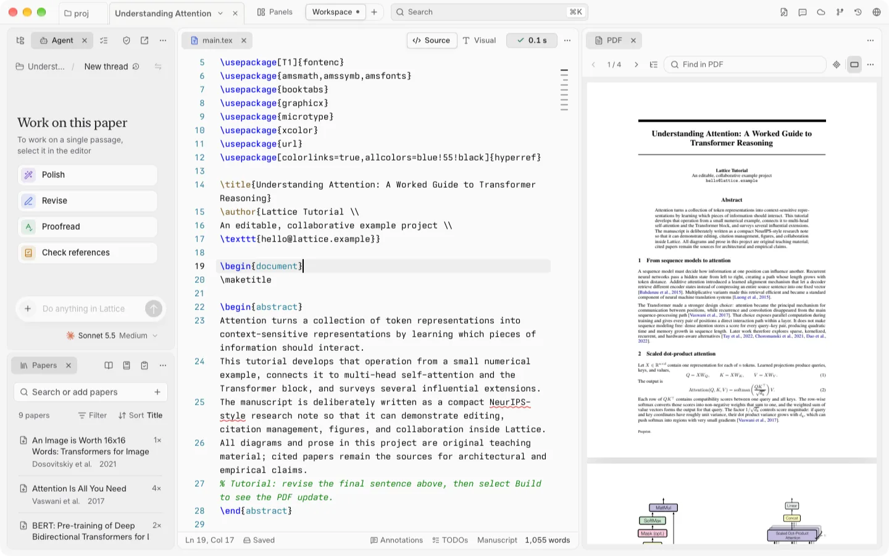

# The Agent

The Agent panel runs a coding agent that reads your project and papers, fixes build errors and edits files. Every change it makes shows as a diff you can review or undo, and lands in [History](history.md). Lattice includes no model or AI subscription of its own: you bring one.

## Connect an agent

Open the **Agent** panel (`⌘⌥3`). Then use one of:

- **Claude Code** or **Codex** on your Mac, signed in as you. Install the CLI, sign in once in Terminal (for example `claude auth login`), and pick it in the model menu under the message box.
- **Another agent CLI** you have installed, such as Cursor, OpenCode or Droid.
- **Your own API**: **Settings › Agent › Model endpoint** takes an **OpenAI-compatible** or **Anthropic-compatible** address (**More protocols** has others), a key (kept in your Keychain) and the **Models to offer**; **Test connection** checks it. The Agent runs it through Pi, a one-time download of about 150 MB that you install under **Settings › Agent › Providers**; no command-line tool is needed. Proofread, Polish and revision requests use the endpoint only once you choose one of its models as the proofreading model under **Providers**.

The rest of **Settings › Agent**:

- **Providers** sets the default provider and the models Lattice uses for its own small tasks (proofreading, commit messages, compile repair).
- **Display** sets the Agent's font size, from 11 to 20 px, apart from the editors' sizes.
- **MCP** adds tools such as Zotero to the Agent; **Skills** manages the skills it can use; **Usage & limits** shows what you have used.
- **Archived threads**: see [below](#threads).
- **Environment** shows the variables the Agent receives, read from your login shell and macOS's proxy settings, with **Restart agent** to pick up a change.

Providers, MCP, Skills, Usage & limits and Archived threads need a project open.

## Work with it

- Type what you want in the message box and press Return. Mention a file to point it there.
- To attach files to a message, choose **+ › Files and folders**, or drop them from the Finder on the Agent panel. Any kind of file works, such as a Word document or a spreadsheet; the Agent gets the file, and it isn't added to your project.
- **Polish**, **Revise**, **Proofread** and **Check references** start common tasks. To work on one passage, select it in the editor first.
- In the editor, select text to **Proofread** (`⌘⌥P`), **Polish** or **Rewrite with an instruction** in place (**Rewrite selection…** in the command palette), with a reason for each edit.
- **Annotate** a passage (select it, choose **Annotate**, write what should change), then **Save and revise now**: the Agent proposes an edit for each annotation and you accept or reject it in place. **Revise from annotations** in the command palette does every open annotation in rounds.
- A failed build's **Ask the agent** sends that problem straight here.
- The permission menu in the panel's header decides when the Agent asks first: **Never ask**, **Ask for risky actions**, or **Ask before outside edits and network**.
- Long lines in the Agent's diffs wrap. The wrap button in a diff's toolbar, or `⌥Z`, turns wrapping off and on again, and Lattice remembers the choice.

## Threads

Threads are kept per project; the clock next to the thread name lists earlier ones. **Settings › Agent › Archived threads** lists archived threads, such as ones archived after a while unused, and can restore one to the history or delete it for good.

Threads you had in the classic version show up as well. Each time the Agent starts, it adds the classic version's threads it doesn't have yet and says how many in a short notice. When you continue one, the Agent's first reply gets a condensed recap of it: the last few messages in more detail, older ones shortened, and the oldest left out of a long thread. It doesn't get the classic version's tool calls, checkpoints or session.

## A window of its own

**Open in separate window** in the Agent panel's header (or **Open the Agent in a separate window** in the command palette) moves the Agent into its own window, with the thread, your draft and a running reply intact. **Return the Agent to the workspace** in the command palette, or closing the window, puts it back. The window keeps its place and size for each project, and opens again with the project.
