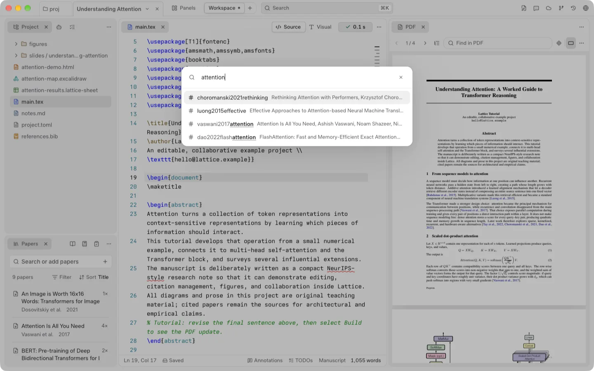
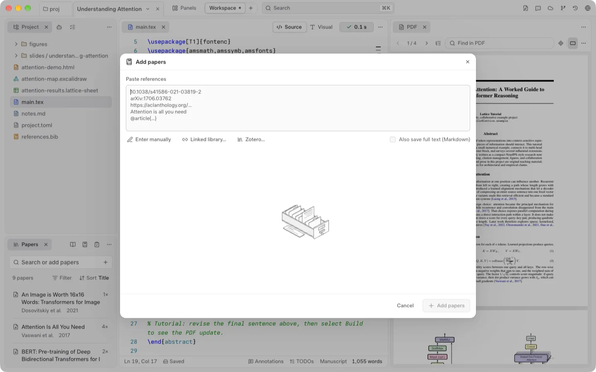

# Citations and papers

## Cite and reference while you type

- `⌘⇧K` **Insert citation**: search your bibliography by key, title or author, then press Return. Lattice inserts `\cite{key}` at the cursor.
- `⌘⇧L` **Insert reference**: search the labels in your project (`eq:`, `fig:`, `tab:` and so on) and insert `\ref{…}`.
- Hover a `\cite` key to see the reference it points to, or press `⌘⌥K` with the cursor on it.

## The Papers library

The **Papers** panel (`⌘⌥2`) holds the papers this project cites, with how many times each is cited. Open one to read it beside your draft, or drag it into the editor to cite it. **Filter papers** narrows the list, and **Sort and group** chooses its order and grouping.

To add papers, click **+** in the **Search or add papers** box (or the Add papers button in the panel's toolbar), or just paste into that box. Paste anything you have: DOIs, arXiv IDs, links, titles or whole BibTeX entries, one per line. Then choose **Add papers** (it reads **Add 3 papers** once Lattice has found them). Lattice looks each one up and writes it into your `.bib` file.

Other ways in, from the same sheet:

- **Enter manually**: type the fields yourself.
- **Linked library…**: link a `.bib` exported from Zotero, Paperpile or another manager, and take in its later changes after you review them.
- **Zotero…**: see [below](#zotero).
- **Also save full text (Markdown)**: keep a readable copy of each paper in the project.

**Discover literature**, beside Add papers, searches literature services for papers to add.

## Check references

**Check references** (in the Papers panel and the command palette) checks every reference against its published record (Semantic Scholar first, then other sources for what it can't answer). Choose **Check all**, or tick references and choose **Check selected**. The report sorts them by what each asks of you: a fix to apply, a candidate to review, a check that couldn't finish, and the ones verified. **Apply** writes one fix into your `.bib`; **Apply all** takes every fix that only fills in or publishes an entry, and leaves disputed values to you. The report is kept, so it is there next time.

## Zotero

You don't need to change anything in Zotero, and it can be open or closed.

1. In **Add papers**, choose **Zotero…**.
2. Open **My Library** or a folder; turn on **Include subfolders** to see everything below it.
3. Tick the papers you want, or **Select all**, and choose **Add N papers**. Papers already in the library show **In Papers**; you can still tick one to bring in what it lacks, and the button then reads **Add PDF**, **Add annotations** or **Add PDF and annotations**.

Annotations you made on a paper's PDF in Zotero come along into its note (`notes/<key>.md`), each with a link to its page. Lattice only reads from Zotero; it never writes back. If Lattice can't find your library, choose its folder with **Choose Zotero folder…**. More detail, including connecting Zotero to the Agent, is in [Zotero, Heptabase and the Agent panel](https://github.com/lattice-writer/lattice/blob/main/docs/zotero-and-notes.md).
