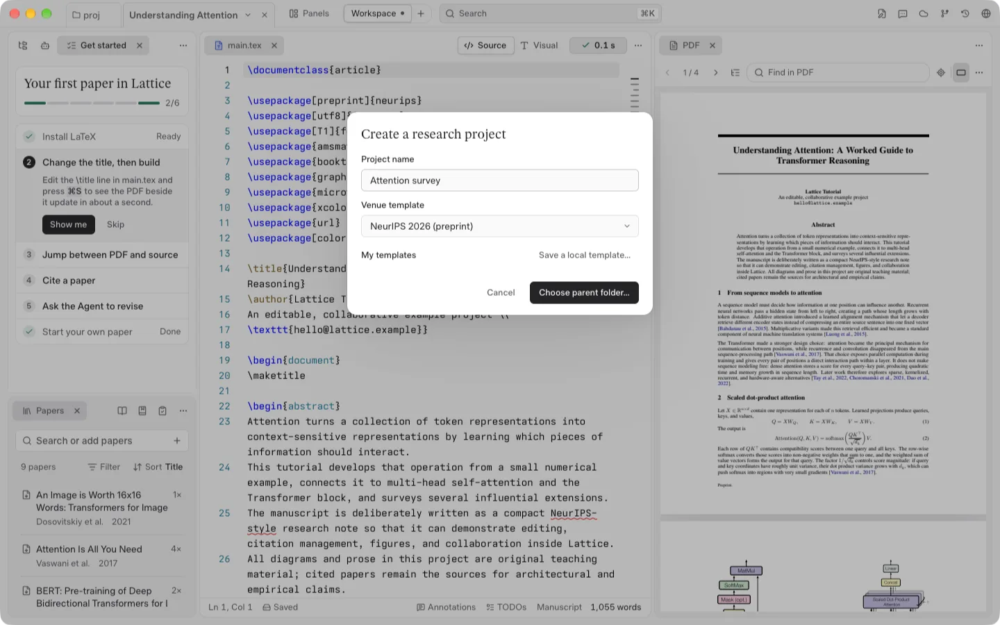
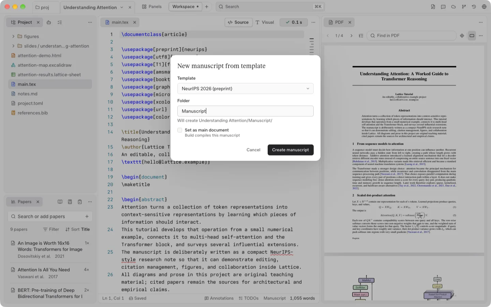

# Getting started

## Install Lattice

1. Download the `.dmg` from the [latest release](https://github.com/lattice-writer/lattice/releases/latest) and drag Lattice into Applications. On an Intel Mac, take the file ending in `_x64.dmg`. With Homebrew: `brew install --cask lattice`.
2. Open Lattice. It updates itself: when a new version is ready, **Lattice › Restart to Update…** installs it. **Settings › Editor & builds › App updates** shows the version you run and has **Check for updates**.

Lattice needs macOS 14 or later. Windows and Linux builds are experimental, run the classic app and have no Agent; this guide describes the Mac app.

## The native Lattice

On a Mac, Lattice is the native app: the Mac draws it itself instead of as a web page, on Apple silicon and Intel Macs alike. Since version 0.20.0 it replaces the classic version, which Windows and Linux keep. Updating a classic copy installs the native one in its place with nothing to choose, and a classic copy of 0.20.0 or later installs it the moment it starts, with a short notice while it downloads.

- **What comes with you:** your recent projects, settings, themes, plugins, project templates, Agent skills and Overleaf links. Your Agent conversations come along too: each time the native version starts its Agent, it adds the classic version's conversations it doesn't have yet, and says how many in a short notice. Your project folders are untouched either way.
- **If you had switched back:** versions 0.19.0 to 0.19.4 could switch back to the classic version. If you did, the native version starts with its own settings and adds what you did in the classic version since: the projects you opened, the settings you changed there (a setting the native version already held at a value of its own keeps it, including one it brought over from the classic version the first time), and the themes, plugins, templates and skills you added.
- **What's different:** the native version checks spelling with macOS's own checker and has no grammar check or dictionaries for other languages. There is no way back to the classic version on a Mac; its data stays on your Mac, untouched.

## Set up TeX

Lattice builds PDFs with your own TeX installation (MacTeX or TeX Live). If you have none, Lattice offers to install **BasicTeX** for you: it is the first step of the Get started checklist, and a build that finds no TeX offers it too. A missing LaTeX package found during a build can also be installed from the build problem itself. Typst documents need no TeX at all; see [Typst documents](typst.md).

To check your setup at any time, open **Settings › TeX doctor**. It lists every tool a build uses and what the open project needs (its root document, bibliography, venue packages and fonts). **Ready to compile** means you are set. If something is red, **Install required tools** installs it. Adding papers and looking up citations need a small Python tool (`uv`), which the same button installs; the Get started panel's **Install paper tools** does the same (about 45 MB).

## Open or create a project

The project menu (the project name at the top left of the window) and the **File** menu hold the ways to open and start projects:

- **Open another folder** (`⌘O`, **File › Open…**): any folder with a `.tex` or `.typ` file. Lattice works on it in place. In the project menu, **Open a folder in this window** opens it as a tab of the window you're in.
- **New project** (`⌘⇧N`): the **Create a research project** dialog. Give it a **Project name**, pick a **Venue template** (blank article, Chinese article with ctexart, NeurIPS, ICML, ICLR, ACL, CVPR and the CVPR rebuttal, AAAI, IEEE conference and journal, ACM, Tsinghua and USTC theses, or **Blank Typst document**) or one of **My templates**, then **Choose parent folder…**. The folder you pick holds the project's own folder, and the dialog shows what it will make (for example **Will create ProjectA/Manuscript/**) before you press **Create project**. It warns you when the parent folder already has the project's name, so you don't end up with `Manuscript/Manuscript/`.
- **Clone repository…**: a Git repository from GitHub or elsewhere.
- **Open from Overleaf**: see [Overleaf sync](overleaf.md).
- **File › Import Overleaf ZIP…**: a project downloaded from Overleaf as a ZIP.

Recent projects are at the top of the project menu and in **File › Open Recent**. A window can hold several projects as tabs in the title bar.

When the folder you open isn't a project yet but holds exactly one, such as `ProjectA/` with the project `ProjectA/Manuscript/` inside, Lattice asks before making a second project of it: open `Manuscript` with the whole folder available to the Agent? **Open Manuscript** keeps its one history and builds where they are, and lets the Agent read and edit everything in `ProjectA/`, such as your analysis scripts; opening `ProjectA/` later opens `Manuscript` straight away. **Make this folder its own project** starts a new project in `ProjectA/`. **Settings › Agent › Display** shows which folder the Agent works in under **Agent’s folder**, and can put it back to the project's own folder. The project menu's **This project** section shows where History, Builds and the Agent work.

### A repository with several manuscripts

A project is just a folder, so it can be a whole repository: analysis code, data and one or more papers side by side. Opening the repository's root as the project lets the Agent work across all of it, for example checking a number in the Results against the output in `analysis/` and then revising the paper in the same conversation.

Start each paper with **New manuscript from template…**. It is on a folder's right-click menu, on the Project panel's own right-click menu, in its **+** menu and in the command palette (`⌘K`). Pick a **Template** (the same ones New project offers, your saved templates included) and a **Folder** (`Manuscript` to start with), and optionally tick **Set as main document** so **Build** compiles it. **Create manuscript** writes the template's files into that folder and opens its main file. The project that is open stays open, with its settings, history and Agent conversations; no second project is made. If any of the files is already there, nothing is written and the dialog lists the files in the way.

## The Get started checklist

**Guided tutorial** in the project menu opens a sample paper beside **Get started**, a six-step checklist: install LaTeX, change the title and build, jump between PDF and source, cite a paper, ask the Agent to revise a paragraph, and start your own paper. Each step has **Show me**, and steps you do on your own tick themselves. To reopen the checklist later, run **Show Get started panel** from the command palette (`⌘K`).

