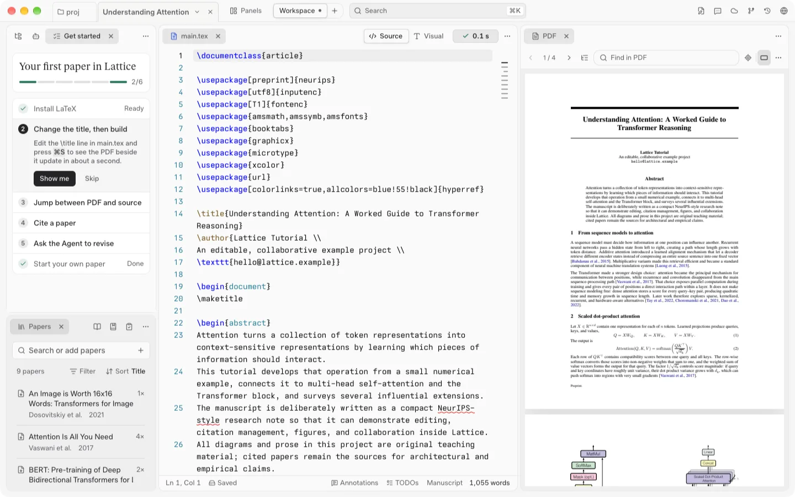

# Getting started

## Install Lattice

1. Download the `.dmg` from the [latest release](https://github.com/lattice-writer/lattice/releases/latest) and drag Lattice into Applications. On an Intel Mac, take the file ending in `_x64.dmg`. With Homebrew: `brew install --cask lattice`.
2. Open Lattice. It updates itself: when a new version is ready, **Lattice › Restart to Update…** installs it. You can change this in **Settings › Editor & builds › App updates**.

Lattice needs macOS 14 or later. Linux (AppImage) and Windows builds are experimental and have no Agent.

## The native Lattice

On a Mac, Lattice is the native app: the Mac draws it itself instead of as a web page, on Apple silicon and Intel Macs alike. Since version 0.20.0 it replaces the classic version, which Windows and Linux keep. Updating a classic copy installs the native one in its place with nothing to choose, and a classic copy of 0.20.0 or later installs it the moment it starts, with a short notice while it downloads.

- **What comes with you:** your recent projects, settings, themes, plugins, project templates, Agent skills and Overleaf links. Your Agent conversations come along too: each time the native version starts its Agent, it adds the classic version's conversations it doesn't have yet, and says how many in a short notice. Your project folders are untouched either way.
- **If you had switched back:** versions 0.19.0 to 0.19.4 could switch back to the classic version. If you did, the native version starts with its own settings and adds what you did in the classic version since: the projects you opened, the settings you changed there (unless you had changed the same setting in the native version), and the themes, plugins, templates and skills you added.
- **What's different:** the native version checks spelling with macOS's own checker and has no grammar check or dictionaries for other languages. There is no way back to the classic version on a Mac; its data stays on your Mac, untouched.

## Set up TeX

Lattice builds PDFs with your own TeX installation (MacTeX or TeX Live). If you have none, Lattice offers to install **BasicTeX** for you: it is the first step of the Get started checklist, and a build that finds no TeX offers it too. A missing LaTeX package found during a build can also be installed from the build problem itself.

To check your setup at any time, open **Settings › TeX doctor**. It lists every tool a build uses and what the open project needs (its root document, bibliography, venue packages and fonts). **Ready to compile** means you are set. If something is red, **Install required tools** installs it; adding papers and looking up citations need a small Python tool (`uv`), which the same button installs.

## Open or create a project

The project menu (the project name at the top left of the window) and the **File** menu have the same actions:

- **Open another folder** (`⌘O`): any folder with a `.tex` file. Lattice works on it in place.
- **New project** (`⌘⇧N`): name it, pick a venue template (NeurIPS, ICML, ICLR, ACL, CVPR, AAAI or a thesis class) or one of your own saved templates, then **Choose location**.
- **Clone repository…**: a Git repository from GitHub or elsewhere.
- **Open from Overleaf**: see [Overleaf sync](overleaf.md).
- **Import Overleaf ZIP…**: a project downloaded from Overleaf as a ZIP.

Recent projects are in **File › Open Recent**. A window can hold several projects as tabs in the title bar.

## The Get started checklist

**Guided tutorial** in the project menu opens a sample paper beside **Get started**, a six-step checklist: install LaTeX, change the title and build, jump between PDF and source, cite a paper, ask the Agent to revise a paragraph, and start your own paper. Each step has **Show me**, and steps you do on your own tick themselves. You can reopen the checklist from **Panels › Get started**.

