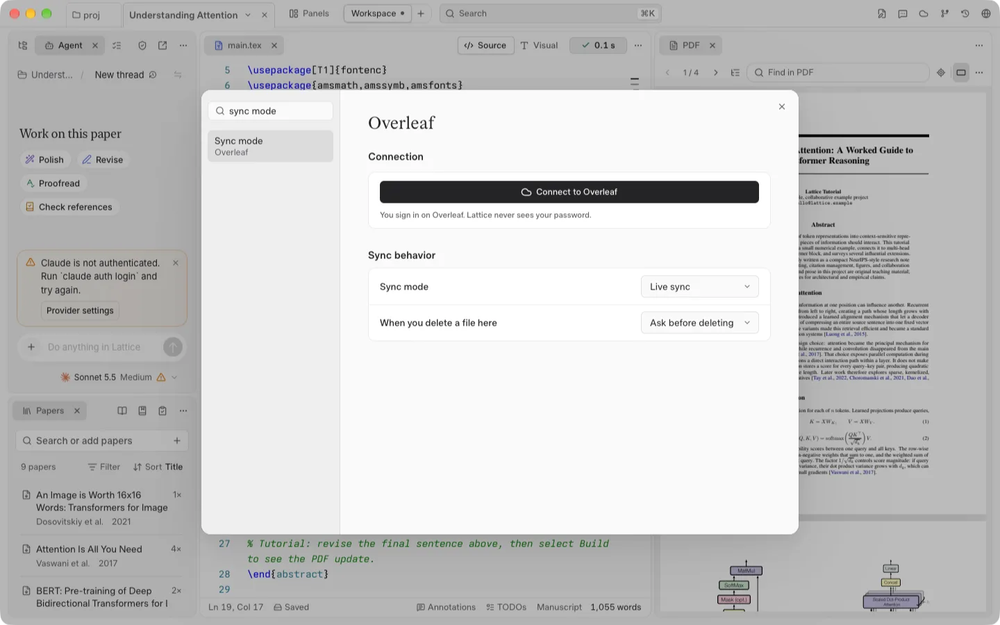

# Overleaf sync

Lattice syncs with Overleaf both ways. Your co-authors keep working on Overleaf and don't need Lattice; their edits, comments, chat and tracked changes show up in Lattice as they happen.

## Connect

Open **Settings › Overleaf** and choose **Connect to Overleaf**. You sign in on Overleaf's own page; Lattice never sees your password. Once connected, the page shows **Connected as** your account, with **Sign out**.

## Open an Overleaf project

1. Choose **Open from Overleaf** in the project menu or the **File** menu, or click the cloud button in the title bar (**Open a project from Overleaf**).
2. Search your projects, or paste a project's link. Projects shared with you as invitations are listed too; accept the invitation on Overleaf first. **Show archived** lists archived projects as well.
3. Under **Download to**, **Choose…** where the local copy goes (`Documents/Overleaf Projects` to start with), then **Open**, or **Open in this window** to open it as a tab of the window you're in.

Lattice downloads the project into an ordinary folder and keeps that folder linked. A project you already have a linked copy of says **Opens your local copy at** its folder, and opening it syncs that copy instead of downloading again. If the download folder already holds files that aren't linked to Overleaf, Lattice asks first: **Link this folder** links them, keeping files that differ side by side and overwriting nothing; **Download a new copy** downloads a fresh copy instead.

## Put a local project on Overleaf

With the project open, choose **Open from Overleaf** and, in the same dialog, **Upload this project to Overleaf**. Give it a name, choose **Upload and connect**, and confirm. The folder stays where it is and is linked to the new Overleaf project.

## How sync behaves

Set in **Settings › Overleaf**:

- **Sync mode**: **Live sync** sends and receives edits as you type. **Manual** syncs only when you choose **Sync now** (in the status bar): it first opens **Review changes**, which lists the files that would change with a diff of each, and **Apply** applies them. A badge says **New changes on Overleaf** when there is something to take in.
- **When you delete a file here**: **Ask before deleting** (the default), **Delete on Overleaf too**, or **Keep it on Overleaf**. Overleaf's history keeps a copy either way.
- **Pause syncing** stops syncing until you choose **Resume syncing**; the page also shows when it **Last synced**.

The status bar says whether a file has reached Overleaf: **Saved and synced**, or **Saved, syncing…** while it is on its way. Click it to **Pause syncing**, or, while it reads **Saved, sync paused**, to **Resume syncing**. The project menu and the command palette (`⌘K`) have **Pause Overleaf sync** and **Resume Overleaf sync** too. A pause holds for that project until you resume, across restarts. Resuming syncs at once (in **Manual** mode it opens **Review changes**), and what changed on both sides while paused is merged as below.

When Overleaf answers "too many requests" and says how long to wait, live sync waits that long, between 30 seconds and 5 minutes. Meanwhile, pointing at the title bar's Overleaf button shows **Overleaf asked to wait, retrying in N s**, and the waiting sync goes out as soon as the wait ends.

When the same file changed on both sides between syncs, Lattice merges the two against the last synced version: prose (.tex, Markdown, text) sentence by sentence, other text files line by line. Edits to different sentences, even in the same paragraph, both survive. Only a spot you both rewrote is marked, in the file itself, with your text and Overleaf's tinted side by side and **Keep mine**, **Keep theirs** and **Keep both** on it; the sync opens the first marked file there. The text from before the merge is kept under `.research/overleaf-conflicts/`, which never syncs.

When a figure or another binary file changed on both sides, the newer copy stays and the other is set aside. A notice says whose copy stayed, with **Use mine** or **Use Overleaf's** to swap.

The PDF that a main document builds never syncs, for every main document in the project. A PDF your source includes as a figure still syncs.

Overleaf refuses some file names, such as one with a backslash or an asterisk, or one starting or ending with a space. Such a file stays on this Mac and everything else keeps syncing; a warning names the file and the rule it breaks. Rename it to sync it. Uploading a project with such a name to Overleaf asks you to rename them first.

## Comments, suggestions and chat

Comments and suggestions from Overleaf appear in the margin of the source and in the Overleaf panel (**Comments**, **Suggestions** and **Chat**). For a linked project, **View › Margin Review** chooses how much the margin shows: **Auto**, **Markers Only** or **Off**.

To comment for your co-authors, select a passage in the source and choose **Comment on Overleaf** in the toolbar beside it. You write the comment in a small box beside the passage, so the sentence stays in view; send it with `⌘↵` and you are back in the text where you left off. The comment is anchored on that passage on Overleaf. **Annotate** in the same toolbar saves a note only you see. A saved note's card has **Share to Overleaf**, which posts the note as an Overleaf comment on its passage. The text of a note and its replies can be selected and copied with `⌘C`.
