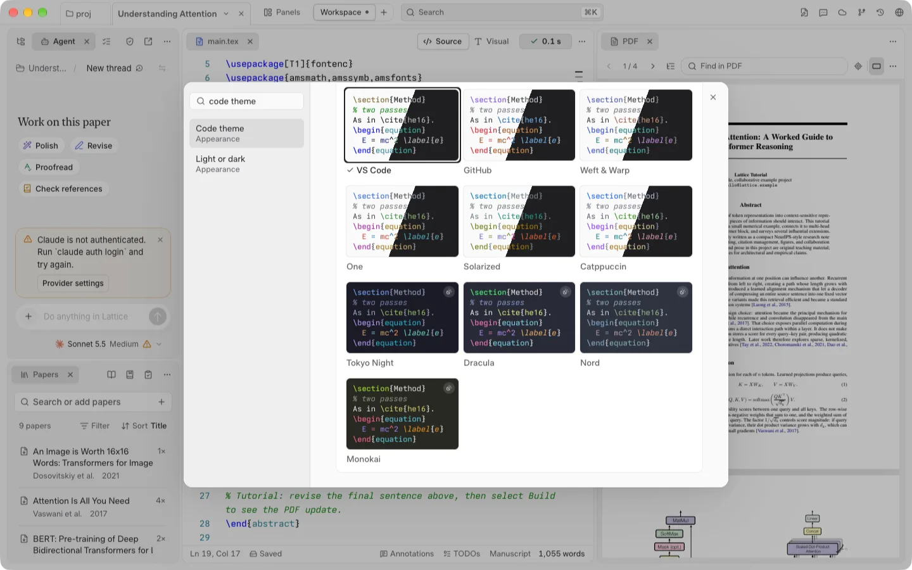

# Plugins and themes

## Themes

Open **Settings › Appearance**. Under **Theme**:

- **Color theme** picks light, dark or the system's appearance.
- **Palette** picks Lattice's own colors or a theme you installed.
- **Tint**, **Accent** and **Translucency** adjust the colors and the frosted window background.
- **Theme files** has **Browse themes…** (themes others have published: choose **Install** on one, then pick it under **Palette**), **Install from file…** (a theme file you were given), **Show themes folder** (where your installed theme files live) and **Remove theme**.

### Code themes

The editor's syntax colors are set separately under **Code theme** on the same page. The default is **VS Code** (its Light+ and Dark+ colors); **GitHub**, **Weft & Warp** (Lattice's own), **One**, **Solarized**, **Catppuccin**, **Tokyo Night**, **Dracula**, **Nord** and **Monokai** are the others. A code theme you chose stays, and a copy of Lattice that already ran the native version keeps GitHub, the default before 0.20.0, until you choose another.

**Light or dark** decides which variant shows: **Match app** follows the app's appearance, or fix **Light** or **Dark**; a theme that comes in one variant only says so. Code blocks in the visual editor use the same code theme as source files. An installed theme that sets its own syntax colors wins over the code theme.

## Plugins

Plugins add commands to the command palette (`⌘K`). Each runs in a sandbox and can reach only what you allow when you turn it on.

Open **Settings › Plugins**. The page has two views, **Installed** and **Browse**, and one search field for whichever view is showing.

### Browse the plugin market

**Browse** lists the plugins in the Lattice plugin market. The list is signed, so Lattice refuses one that has been tampered with, and when you're offline it shows the last list it verified. Sort by most downloaded, recently updated or name, and choose **Refresh** to fetch the list again.

Choose a plugin, or its **Install…** button, to see its details: who made it, its version and licence, what **This plugin can** do and what it can't, and the commands it adds. Then choose:

- **Install and turn on**: installs the plugin and turns it on.
- **Install only**: installs it turned off, to turn on later.

### Installed plugins

Each installed plugin shows where it came from: **Reviewed** for a plugin from the market, **Not reviewed** for one installed from a URL, **Developer** for a folder. Turn a plugin on or off with its switch; turning it on asks first (**Turn on Name?**) and lists what it will be able to do. A plugin that needs a key or a token gets a field for it on its card, with **Save** and **Clear**. Remove a plugin from its card.

When an update is available, the card says so with **Update…**. **Update all** applies every update that asks for nothing new. An update that asks for more than you allowed says **Asks for new permissions** and waits on its own card; **Review…** lists only what is new, with **Allow and update**, or **Keep** the version you have (for example **Keep 1.2.0**).

If a plugin is withdrawn from the market, Lattice turns it off and says why on its card (**Learn more**). Plugins run on macOS only for now.

### Install a plugin yourself

- **Install from URL…**: a plugin's `.zip` release over `https`, checked against the SHA-256 its author publishes.
- **Install from folder…**: for developing a plugin; Lattice runs the folder in place, so your edits apply on the next run.

Writing a plugin or a theme? Start with [Your first plugin](plugin-development.md) or [Making a theme](theme-development.md).
