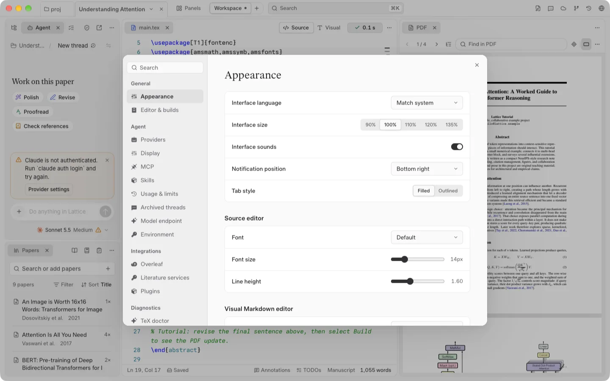
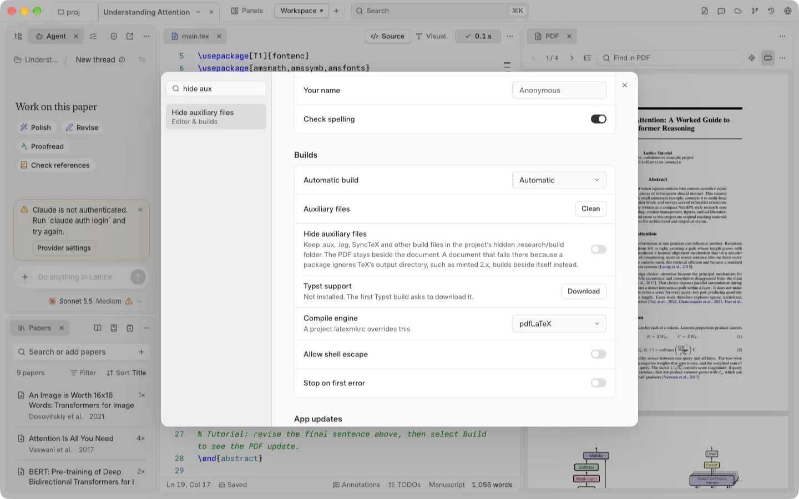

# Settings and shortcuts

## Settings

Open **Lattice › Settings…** (`⌘,`). The search box at the top finds any setting by name, and by the words you might use for it: "frosted glass" finds **Translucency**, ".aux" finds **Hide auxiliary files**.

| Section | Page | What's there |
| --- | --- | --- |
| **General** | **Appearance** | Interface language (**Match system**, English or Simplified Chinese), interface size, sounds, notification position, tab style; font, size and line height for the source and Visual Markdown editors; **Theme** (color theme, palette, theme files, tint, accent, translucency); **Code theme**; **Title bar tools**. See [Plugins and themes](plugins-and-themes.md). |
| | **Editor & builds** | **Editor**: keymap (default, Vim or Emacs), your name, **Check spelling** (macOS's checker). **Builds**: automatic build, auxiliary files and **Hide auxiliary files**, Typst support, and with a project open the compile engine, shell escape, **Stop on first error** and Live preview. **App updates**: the version and **Check for updates**. See [Building](building.md). |
| **Agent** | | Providers, Display, MCP, Skills, Usage & limits, Archived threads, Model endpoint, Environment. See [The Agent](agent.md). |
| **Integrations** | | [Overleaf](overleaf.md), Literature services (keys for literature search), [Plugins](plugins-and-themes.md#plugins). |
| **Diagnostics** | | TeX doctor, Logs. |
| **About** | | Acknowledgements. |

`⌘+`, `⌘−` and `⌘0` (or **View › Bigger / Smaller / Actual Size**) change the interface size, the same setting as **Appearance › Interface size**, for every window.

## Shortcuts

Press `⌘?` (`⌘⇧/`) for **Keyboard shortcuts**, the full list, with a filter by name or key. Shortcuts follow the commands you have, so the list is always current. The ones worth learning first:

| Keys | Action |
| --- | --- |
| `⌘K` | Command palette: every command by name |
| `⌘S` | Save and build |
| `⌘P` | Quick open a file |
| `⌘⇧K` / `⌘⇧L` | Insert citation / reference |
| `⌘⇧J` | Jump to PDF |
| `F8` / `⇧F8` | Next / previous build problem |
| `⌘⇧F` | Find in project |
| `⌘⌥1`, `⌘⌥2`, `⌘⌥3` | Project, Papers, Agent panel |
| `⌘1` … `⌘9` | Switch workspace |
| `⌘⇧D` | Focus mode |
| `⌘W` / `⌘⇧T` | Close tab / reopen it |

To use Vim or Emacs keys in the editor, set **Settings › Editor & builds › Editor keymap**.
