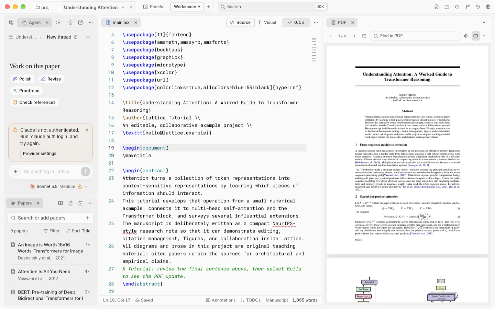

# Troubleshooting and FAQ

## Something went wrong

**The build fails and I don't see why.** Read the first problem in the build card; later ones often follow from it. Open **Log** for LaTeX's own words. Then try **Clean rebuild** from the command palette (`⌘K`), or `⇧`-click the build button. See [Building](building.md).

**"Missing LaTeX dependency" or a package not found.** BasicTeX doesn't include every package Overleaf has. Use the problem's **Install** button, or **Settings › TeX doctor › Install required tools**.

**A build can't find LaTeX at all.** Open **Settings › TeX doctor**. If it lists missing tools, install TeX from the Get started checklist or from [MacTeX](https://tug.org/mactex/), then reopen the project.

**A document builds only with Hide auxiliary files off.** Some packages (minted 2.x, for example) ignore TeX's output directory. Lattice builds such a document beside itself on its own; if it still fails, turn off **Settings › Editor & builds › Hide auxiliary files**. See [Auxiliary files](building.md#auxiliary-files).

**A Typst document doesn't build.** Open **Settings › Editor & builds › Typst support**: if it isn't installed, choose **Download**; if a download failed or an update left it behind, **Download again**. See [Typst documents](typst.md).

**Adding papers or looking up citations doesn't work.** These need the small `uv` tool. **Settings › TeX doctor** shows whether `uv` and `uvx` are there; **Install required tools** installs them.

**The Agent says it isn't signed in.** The panel shows which provider is missing a sign-in, for example "Claude is not authenticated". Sign in once in Terminal (`claude auth login` for Claude Code), then try again, or pick another provider under **Settings › Agent › Providers**.

**Overleaf stopped syncing.** Open **Settings › Overleaf**. If your session expired, choose **Reconnect to Overleaf**; if syncing is paused, **Resume syncing**. A file with conflict markers pauses sync for that file until you choose **Keep mine**, **Keep theirs** or **Keep both** on each marked spot.

**A panel is gone.** **Panels › Reset layout** brings every panel back. To undo a deleted workspace, use **Undo** in the notice right away.

**I lost text.** Open [History](history.md): every save, every Agent edit and every Overleaf change is there, and **Restore this file** puts a file back.

**Something else is wrong.** **Help › Report a Problem…** saves a redacted log you can attach to an issue, and opens [GitHub Issues](https://github.com/lattice-writer/lattice/issues). **Settings › Logs** shows the log in the app, with **Export…**.

## FAQ

**Where is my paper stored?** In the folder you opened or created, as ordinary files. Lattice keeps what it adds (build files when you hide them, Overleaf conflict copies and the like) in the project's hidden `.research` folder and in its own app data, never in your `.tex` files.

**Do I need an AI subscription?** Only for the Agent and the proofreading tools. Everything else, including builds, citations, history and Overleaf sync, works without one. See [The Agent](agent.md).

**Do my co-authors need Lattice?** No. They keep working on Overleaf; see [Overleaf sync](overleaf.md).

**Can I go back to the classic app on my Mac?** No. Since 0.20.0 every Mac runs the native app; the classic app's data stays on your Mac, untouched. See [The native Lattice](getting-started.md#the-native-lattice).

**I use Windows or Linux.** Those builds are experimental and still run the classic app, which has no Agent. Most of this guide applies, but labels and menus differ in places.

**Does Lattice work offline?** Yes, except for what needs the network: Overleaf sync, the Agent with a hosted model, looking up papers, the plugin and theme markets, and first-time downloads such as Typst support and Typst packages. On a Mac, when the website can't be reached, **Help › User Guide** opens the copy of this guide that comes with Lattice.
