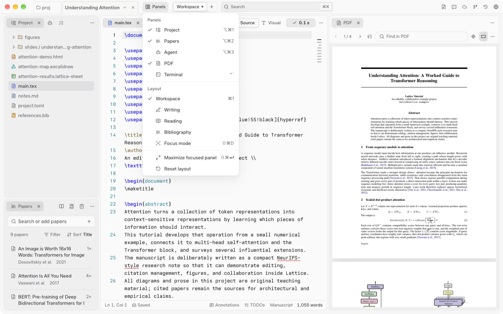

# Panels and workspaces

## Panels

Everything in the window is a panel: Project, Papers, Agent, PDF and Terminal, and tools such as History, Annotations, Overleaf, TODOs and the Submission checklist. The **Panels** menu in the title bar shows or hides the first five; the tools open from their title-bar buttons (History, Annotations, Overleaf, Git) or from the command palette (`⌘K`), for example **Manuscript TODOs** and **Submission checklist**. **Settings › Appearance › Title bar tools** chooses which tool buttons the title bar shows.

- Drag a panel's tab to dock it anywhere: beside, above or below another panel, or as a tab in its group.
- `⌘⌥1` Project, `⌘⌥2` Papers, `⌘⌥3` Agent, `` ⌃` `` Terminal show or hide those panels.
- `⌘⇧↩` (**Maximize focused panel**) maximizes the focused panel and restores the layout again.
- **Focus mode** (`⌘⇧D`) hides everything but the editor.
- **Reset layout** in the Panels menu brings back any panel you closed.

Under **Layout**, the Panels menu lists your workspaces and three ready-made layouts: **Writing**, **Reading** and **Bibliography**.

## Workspaces

A workspace is a saved arrangement of panels. They sit as tabs in the title bar, and `⌘1` to `⌘9` switch between them.

- **Create**: click **+** next to the workspace tabs. The new workspace starts from the layout on screen; type its name and press Return.
- **Save changes**: when you rearrange panels, the workspace tab shows a dot. Right-click the tab and choose **Save to workspace**, or **Revert to saved**.
- **Rename**: double-click the tab, or press F2.
- **Duplicate**: makes a copy and lets you name it.
- **Reorder**: drag the tab, or use **Move left** and **Move right**.

### Delete a workspace

Right-click the workspace's tab and choose **Delete workspace**. If right-clicking doesn't open the menu (some trackpad settings), select the tab and press `⇧F10`. The notice that appears (**Deleted "Name"**) has **Undo**, which brings the workspace back. **Delete workspace** is unavailable while it is the only workspace.

When the window is too narrow for tabs, the workspaces fold into one menu with the same actions.
