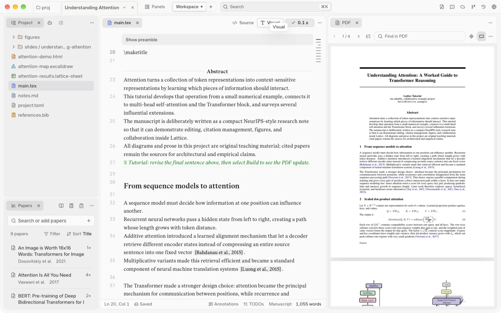

# Writing

## The editor

A `.tex` file opens in the source editor, with completion and diagnostics as you type. Above it, switch between:

- **Source**: the LaTeX as written.
- **Visual**: the same file with headings, emphasis, equations, lists and figures drawn in place. You still edit the same text; switch back any time.

The choice applies to every `.tex` file and is remembered; it is also in the ⋯ menu above the editor.

Useful while writing:

- **Format keys**: `⌘B` bold, `⌘I` emphasis, `⌘⇧M` inline math, `⌘/` comment a line, `⌘⌥E` wrap in an equation, `⌘⇧E` wrap in an environment, `⌘⌥I` an itemize list, `⌘⌥M` math symbols. The full list is in **Keyboard shortcuts** (`⌘?`).
- **Find and replace**: `⌘F` in the file, `⌘⇧F` in the whole project.
- **Go to**: `⌘P` opens any file, `⌘G` a line, `⌘⇧O` a section or label.
- **Outline**: the marks at the right edge of the editor stand for the document's sections; rest the pointer on them for an **Outline** list with each section's number, title and PDF page, and click one to go there. The PDF toolbar's **Outline** button lists the same sections.
- **Citations**: `⌘⌥K` shows the card of the reference whose `\cite` key the cursor is on. See [Citations and papers](citations.md).
- Markdown notes, spreadsheets, HTML pages, slides and [boards](boards.md) live in the same project and open in their own editors. Typst documents have [a page of their own](typst.md).
- **Code files**: Python, TypeScript, JavaScript, Rust, Go, C and C++, Java, R, Lua, shell scripts, YAML, TOML, JSON, Makefiles, Dockerfiles, CSS, HTML and BibTeX open with syntax highlighting. A fenced code block in a Markdown note is highlighted in the same languages and in the same colors as a file of that language, from the [code theme](plugins-and-themes.md#code-themes).
- **Markdown tables**: drag a column border in the visual editor to resize the column, or double-click it to fit the column to its content. Drag a row's bottom border to make the row taller, or double-click it to give the row its content's height again. Widths and heights are remembered for the next time you open the file, and the `.md` file itself stays plain Markdown.
- **Spreadsheets**: Control-click or right-click opens a cell's menu; `⌘`-click adds another range to the selection.

Lattice saves as you type. The status bar shows the line and column, whether the file is saved, and the word count.

## Select text to work on it

Selecting text in the editor shows a small toolbar: **Proofread** (`⌘⌥P`), **Polish**, **Rewrite with an instruction** and **Annotate**. The first three ask the Agent for an edit with a reason for each change, which you accept or reject in place; **Annotate** leaves a note for later. See [The Agent](agent.md#work-with-it).

The PDF beside your source, and jumping between the two, are on [Building and fixing errors](building.md#the-pdf-beside-your-source).
