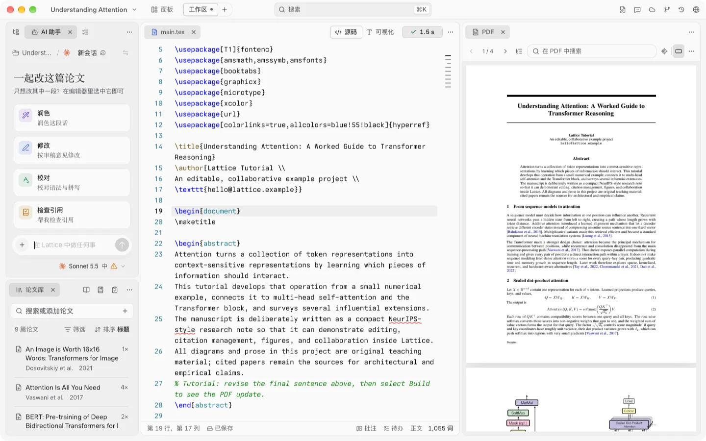

# AI 助手

AI 助手面板运行一个编程智能体：它能读你的项目和论文、修复编译错误、修改文件。它做的每处修改都以差异显示，可以审阅或撤回，并记入 [历史](history.md)。Lattice 本身不附带模型或 AI 订阅，需要你自己提供。

## 接入助手

打开 **AI 助手** 面板（`⌘⌥3`），然后选择一种方式：

- Mac 上以你的身份登录的 **Claude Code** 或 **Codex**。安装命令行工具，在「终端」里登录一次（例如 `claude auth login`），再在输入框下方的模型菜单中选中它。
- 你安装的 **其他智能体命令行工具**，例如 Cursor、Antigravity（`agy`）、OpenCode 或 Droid。Antigravity 未登录时，模型菜单中显示 **登录**，只有点击后才会开始登录。
- **你自己的 API**：**设置 › AI 助手 › 模型接口** 填入 **兼容 OpenAI** 或 **兼容 Anthropic** 的地址（**更多协议** 里还有其他协议）、密钥（保存在钥匙串中）和 **要使用的模型**；**测试连接** 可以检查是否可用。助手通过 Pi 使用这个接口，Pi 需要一次性下载（约 150 MB），在 **设置 › AI 助手 › 模型** 中安装；不需要安装命令行工具。校对、润色和修改请求只有在你于 **模型** 中把接口的某个模型选为校对模型之后才会使用它。

**设置 › AI 助手** 里的其他页面：

- **模型** 设置默认的服务商，以及 Lattice 自己做小任务（校对、提交说明、修复编译）时用的模型。也可以选 Antigravity 的模型来做这些任务；它只读取交给它的文字，`agy` 未登录时，任务会回复它尚未登录，而不会打开登录页面。
- **显示** 设置助手的字号，范围 11 到 20 px，与编辑器的字号分开。
- **MCP** 可以给助手添加 Zotero 等工具；**技能** 管理它能用的技能；**用量与限制** 显示用了多少。
- **已归档的对话**：见 [下文](#会话)。
- **环境变量** 显示助手收到的环境变量，来自你的登录 shell 和 macOS 的代理设置；改动后用 **重启 AI 助手** 让它生效。

模型、MCP、技能、用量与限制和已归档的对话需要先打开一个项目。

## 使用

- 在输入框写下你的要求，按回车。提到某个文件，它就会去看那个文件。
- 要给消息附上文件，选择 **+ › 文件和文件夹**，或者从访达把文件拖到 AI 助手面板上。任何类型的文件都可以，例如 Word 文档或电子表格；文件只交给助手，不会加入你的项目。
- **润色**、**修改**、**校对** 和 **检查引用** 用来启动常见任务。只想改其中一段时，先在编辑器里选中它。
- 在编辑器里选中文字后，可以直接 **校对**（`⌘⌥P`）、**润色** 或 **按指令改写**（命令面板里是 **按指令改写…**），每处修改都附带理由。
- **批注** 一段文字（选中，选择 **批注**，写下要怎么改），再点 **保存并立即修改**：助手为每条批注提出修改，你在原处接受或拒绝。论文拆成多个章节文件时，助手还会读取主文档的导言区；批注靠近文件开头或结尾时，也会读取论文中紧挨着它之前或之后的文字，但只修改被批注的那段。命令面板里的 **根据批注修改** 会分轮处理所有未完成的批注。
- 编译失败时，问题上的 **交给助手** 会把它直接发到这里。
- 面板标题栏的权限菜单决定助手什么时候先问你：**从不问我**、**有风险时问我** 或 **改外部文件、联网前问我**。
- 助手的差异视图中，过长的行会自动换行。差异工具栏上的换行按钮或 `⌥Z` 可以关闭或重新打开换行，Lattice 会记住你的选择。

## 会话

会话按项目保存；会话名旁边的时钟图标列出之前的会话。**设置 › AI 助手 › 已归档的对话** 列出已归档的会话（例如闲置一段时间后自动归档的），可以把会话恢复到历史记录，也可以永久删除。

你在经典版本里的会话也会出现。每次助手启动时，都会补上经典版本里它还没有的会话，并用一条简短的提示告诉你带来了多少个。继续这样的会话时，助手的第一次回复会收到它的精简回顾：最近几条消息较详细，较早的消息被缩短，很长的会话会略去最早的部分。经典版本中的工具调用、检查点和会话状态不会带过来。

## 单独的窗口

点助手面板标题栏上的 **在单独窗口中打开**（或在命令面板中运行 **在单独窗口中打开 AI 助手**），助手会移到它自己的窗口里，会话、草稿和正在进行的回复都原样保留。在命令面板中运行 **把 AI 助手放回工作区**，或关掉这个窗口，它就回到原处。窗口的位置和大小按项目记住，并随项目一起重新打开。
