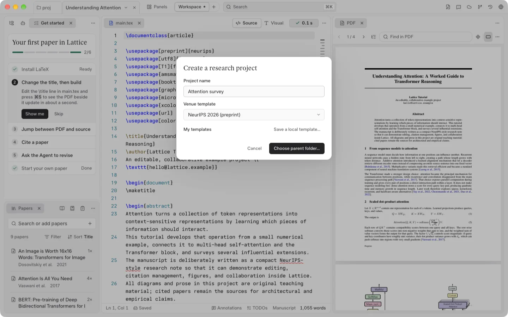
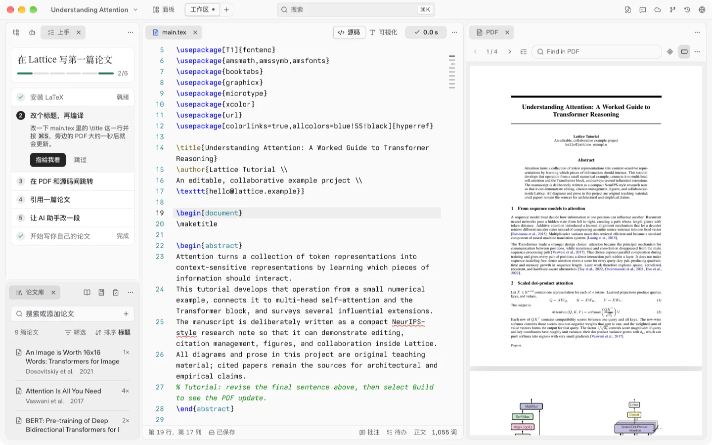

# 快速上手

## 安装 Lattice

1. 从 [最新版本](https://github.com/lattice-writer/lattice/releases/latest) 下载 `.dmg`，把 Lattice 拖进「应用程序」。Intel Mac 请下载以 `_x64.dmg` 结尾的文件。也可以用 Homebrew：`brew install --cask lattice`。
2. 打开 Lattice。它会自动更新：新版本下载好后，**Lattice › 重新启动以更新…** 即可安装。可在 **设置 › 编辑编译 › 更新** 中修改。

Lattice 需要 macOS 14 或更高版本。Linux（AppImage）和 Windows 版本仍是实验性的，没有 AI 助手。

## Apple 芯片 Mac 上的原生 Lattice

在搭载 Apple 芯片的 Mac 上，Lattice 可以切换到它的原生版本：界面由 Mac 直接绘制，而不再是网页，外观和用法都一样。带来这个功能的更新之后，Lattice 会询问一次；选了 **以后再说** 或 **不再询问** 之后，也可以随时在 **设置 › 编辑编译 › 切换到新的 Lattice** 中切换。

- **会带过去的：** 第一次切换时，最近的项目、设置、主题、插件、项目模板、Agent 技能和 Overleaf 关联。Agent 对话也会带过去：原生版本每次启动 Agent 时，都会加入经典版本里它还没有的对话，并用一条简短的提示说明加入了多少个。项目文件夹本身无论如何都不受影响。
- **不一样的地方：** 原生版本用 macOS 自带的检查器检查拼写，没有语法检查，也没有其他语言的词典。
- **切换回去：** 在原生版本中打开 **设置 › 编辑编译 › 切换回经典版本**，就会把经典版本装回原处。经典版本打开时，数据和切换前一样；在原生版本里做的改动不会同步回来。以后再次切换时，原生版本保留它自己的设置、主题、插件和 Overleaf 登录，并加入你在经典版本里打开过的最近项目和新开始的 Agent 对话。

## 配置 TeX

Lattice 使用你自己的 TeX 发行版（MacTeX 或 TeX Live）编译 PDF。如果还没有安装，Lattice 可以帮你安装 **BasicTeX**：这是「上手」清单的第一步，找不到 TeX 的编译也会提示安装。编译时发现缺少的 LaTeX 宏包，也可以直接在编译问题里安装。

随时可以打开 **设置 › TeX 检查** 查看环境。它列出编译用到的每个工具，以及当前项目需要的东西（主文档、参考文献、会议模板宏包和字体）。显示 **可以编译了** 就说明一切就绪。有红色项时，点 **安装所需工具** 即可；添加论文和查找引用需要一个小的 Python 工具（`uv`），同一个按钮也会安装它。

## 打开或新建项目

左上角的项目名菜单和 **文件** 菜单里有相同的操作：

- **打开文件夹**（`⌘O`）：任何包含 `.tex` 文件的文件夹，Lattice 直接在原处编辑。
- **新建项目**（`⌘⇧N`）：起个名字，选一个会议模板（NeurIPS、ICML、ICLR、ACL、CVPR、AAAI 或学位论文模板）或你自己保存的模板，再点 **选择位置**。原生版 Lattice 里这个按钮叫 **选择上级文件夹…**：你选的文件夹里会新建项目自己的文件夹，点 **创建项目** 之前对话框会写明将要创建什么（例如 **将创建 ProjectA/Manuscript/**）。如果上级文件夹已经和项目同名，它会提醒你，免得建出 `Manuscript/Manuscript/`。
- **克隆仓库…**：来自 GitHub 或其他地方的 Git 仓库。
- **从 Overleaf 打开**：见 [Overleaf 同步](overleaf.md)。
- **导入 Overleaf ZIP…**：从 Overleaf 下载的 ZIP 项目。

最近的项目在 **文件 › 打开最近使用**。一个窗口可以在标题栏以标签形式打开多个项目。

### 一个仓库里放多篇稿件

项目就是一个文件夹，所以它可以是整个代码仓库：分析代码、数据和一篇或几篇论文放在一起。把仓库根目录作为项目打开，Agent 就能在整个仓库里工作，比如先拿 `analysis/` 的输出核对结果部分的一个数字，再在同一个对话里修改论文。

在原生版 Lattice 里，每篇论文都可以用 **从模板新建稿件…** 开始。它在文件夹的右键菜单、项目面板空白处的右键菜单、面板的 **+** 菜单和命令面板里。选一个模板（和新建项目里的一样，也包括你保存的模板）和文件夹名，需要的话勾上 **设为主文档**，这样 **编译** 会编译它。Lattice 把模板文件写进这个文件夹并打开主文件。当前项目保持打开，设置、历史和 Agent 对话都不变，也不会另建项目。如果其中有文件已经存在，就什么也不写，对话框会列出这些文件。

## 「上手」清单

项目菜单中的 **新手教程** 会打开一篇示例论文，旁边是 **上手** 清单，共六步：安装 LaTeX、修改标题并编译、在 PDF 和源码之间跳转、引用一篇论文、让 AI 助手修改一段话、开始写你自己的论文。每一步都有 **指给我看**，自己完成的步骤会自动打勾。可以从 **面板 › 上手** 重新打开清单。

