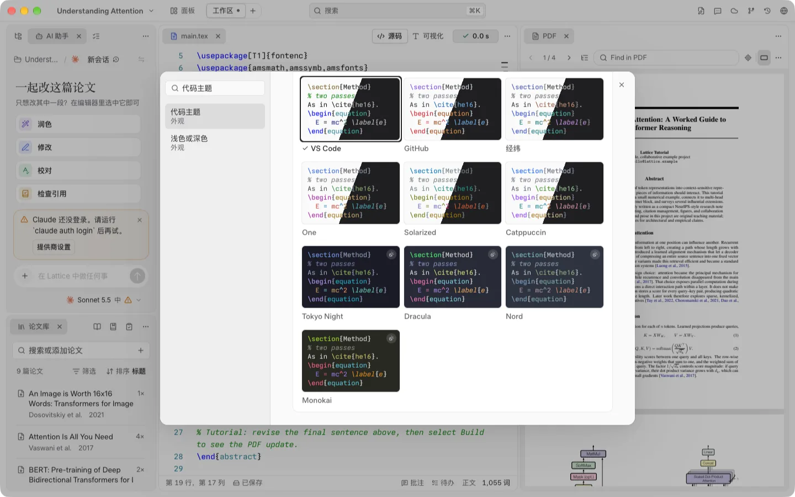

# 插件与主题

## 主题

打开 **设置 › 外观**。在 **主题** 下：

- **颜色主题** 选择浅色、深色或跟随系统。
- **配色** 选择 Lattice 自己的配色，或你安装的主题。
- **色调**、**主题色** 和 **毛玻璃** 调整颜色和窗口的半透明背景。
- **主题文件** 里有 **浏览主题…**（别人发布的主题：点某个主题的 **安装**，再在 **配色** 中选中它）、**从文件安装…**（别人发给你的主题文件）、**显示主题文件夹**（已安装的主题文件所在的位置）和 **移除主题**。

### 代码主题

编辑器的语法配色在同一页的 **代码主题** 中单独设置。默认是 **VS Code**（它的 Light+ 和 Dark+ 配色），其他可选的有 **GitHub**、**经纬**（Weft & Warp，Lattice 自己的配色）、**One**、**Solarized**、**Catppuccin**、**Tokyo Night**、**Dracula**、**Nord** 和 **Monokai**。你选过的代码主题会保留；已经用过原生版本的 Lattice 会保留 0.20.0 之前的默认主题 GitHub，直到你另选一个。

**浅色或深色** 决定显示哪种变体：**跟随应用** 随应用的外观切换，也可以固定为 **浅色** 或 **深色**；只有一种变体的主题会注明。可视编辑器里的代码块和源码文件使用同一个代码主题。已安装的主题如果自带语法配色，会优先于代码主题。

## 插件

插件会往命令面板（`⌘K`）里添加命令。每个插件都在沙盒中运行，只能访问你开启时允许的内容。

打开 **设置 › 插件**。这一页有 **已安装** 和 **浏览** 两个视图，共用一个搜索框，搜索当前显示的视图。

### 浏览插件市场

**浏览** 列出 Lattice 插件市场中的插件。列表带有签名，被篡改的列表会被拒绝；离线时显示最后一次校验通过的列表。可以按下载最多、最近更新或名称排序，点 **刷新** 重新获取列表。

点某个插件或它的 **安装…** 按钮查看详情：作者、版本和许可证、**此插件可以** 做什么和不能做什么，以及它添加的命令。然后选择：

- **安装并启用**：安装插件并开启。
- **仅安装**：安装但保持关闭，之后再开启。

### 已安装的插件

每个已安装的插件都标明来源：来自插件市场的是 **已审核**，从 URL 安装的是 **未经审核**，从文件夹安装的是 **开发者**。用开关开启或关闭插件；开启前会先问你，并列出它将能做什么。需要密钥或令牌的插件会在卡片上为它留一个输入框，并有保存和清除。在插件卡片上可以移除插件。

有更新时，卡片上会提示。**全部更新** 会应用所有不需要新权限的更新。需要比你已允许的更多权限的更新会单独留在卡片上；**查看…** 只列出新增的部分，可以选择 **允许并更新**，或 **保留** 当前版本（例如「保留 1.2.0」）。

如果某个插件被从市场撤下，Lattice 会将其关闭，并在卡片上说明原因（**了解更多**）。插件目前只能在 macOS 上运行。

### 自己安装插件

- **从 URL 安装…**：通过 `https` 下载插件的 `.zip` 发布包，并核对作者公布的 SHA-256。
- **从文件夹安装…**：用于开发插件；Lattice 直接运行这个文件夹，你的修改在下次运行时生效。

想写插件或主题？从 [第一个插件](plugin-development.md) 或 [制作主题](theme-development.md) 开始。
