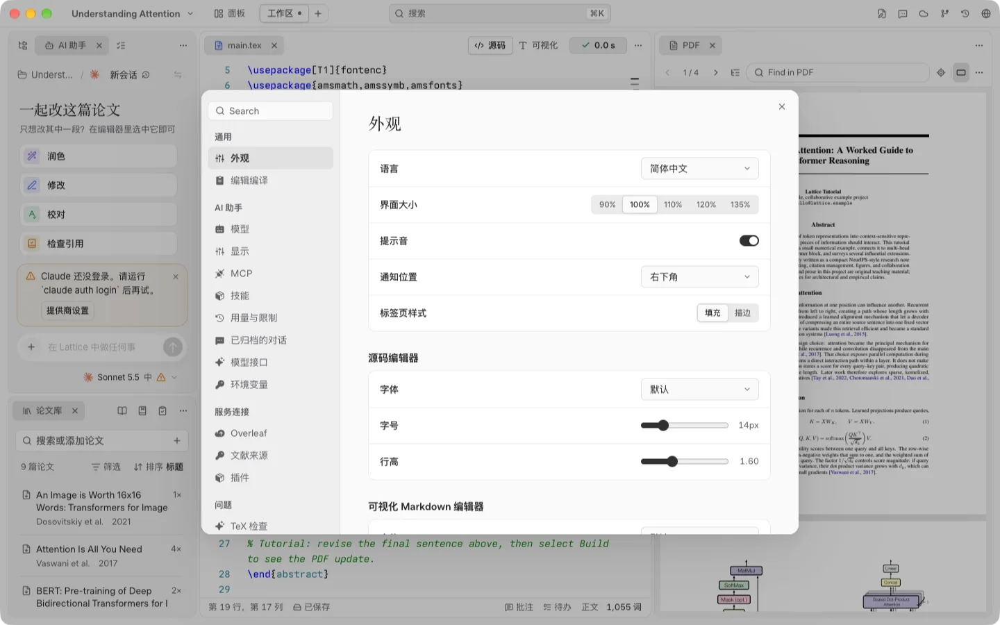
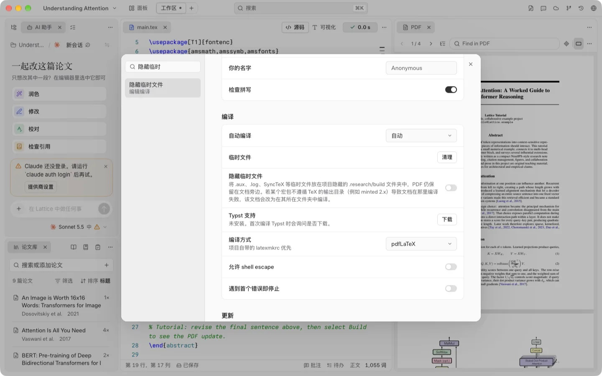

# 设置与快捷键

## 设置

打开 **Lattice › 设置…**（`⌘,`）。顶部的搜索框可以按名称找到任何设置，也认得你可能用的说法：搜「.aux」会找到 **隐藏临时文件**。

| 分组 | 页面 | 内容 |
| --- | --- | --- |
| **通用** | **外观** | 语言（**跟随系统**、English 或简体中文）、界面大小、声音、通知位置、标签样式；源码编辑器和可视化 Markdown 编辑器的字体、字号和行高；**主题**（颜色主题、配色、主题文件、色调、主题色、毛玻璃）；**代码主题**；**标题栏工具**。见 [插件与主题](plugins-and-themes.md)。 |
| | **编辑编译** | **编辑器**：键盘方案（默认、Vim 或 Emacs）、你的名字、**检查拼写**（使用 macOS 的检查器）。**编译**：自动编译、临时文件和 **隐藏临时文件**、Typst 支持，打开项目后还有编译方式、shell escape、**遇到首个错误即停止** 和实时预览。**更新**：当前版本和 **检查更新**。见 [编译与排错](building.md)。 |
| **AI 助手** | | 模型、显示、MCP、技能、用量与限制、已归档的对话、模型接口、环境变量。见 [AI 助手](agent.md)。 |
| **服务连接** | | [Overleaf](overleaf.md)、文献来源（文献检索用的密钥）、[插件](plugins-and-themes.md#插件)。 |
| **问题** | | TeX 检查、日志。 |
| **关于** | | 致谢。 |

`⌘+`、`⌘−` 和 `⌘0`（或 **视图 › 放大 / 缩小 / 实际大小**）调整界面大小，与 **外观 › 界面大小** 是同一个设置，对所有窗口生效。

## 快捷键

按 `⌘?`（`⌘⇧/`）打开 **快捷键**，查看完整列表，可以按名称或按键筛选。列表跟随当前可用的命令，因此总是最新的。值得先记住的几个：

| 按键 | 作用 |
| --- | --- |
| `⌘K` | 命令面板：按名称找到任何命令 |
| `⌘S` | 保存并编译 |
| `⌘P` | 快速打开文件 |
| `⌘⇧K` / `⌘⇧L` | 插入引用 / 引用编号 |
| `⌘⇧J` | 在 PDF 中查看 |
| `F8` / `⇧F8` | 下一个 / 上一个编译问题 |
| `⌘⇧F` | 在项目中查找 |
| `⌘⌥1`、`⌘⌥2`、`⌘⌥3` | 项目、论文库、AI 助手面板 |
| `⌘1` … `⌘9` | 切换工作区 |
| `⌘⇧D` | 专注 |
| `⌘W` / `⌘⇧T` | 关闭标签 / 重新打开 |

想在编辑器里用 Vim 或 Emacs 按键，在 **设置 › 编辑编译 › 键盘方案** 中设置。
