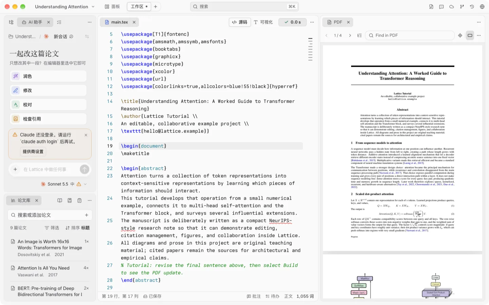

# 常见问题与排错

## 出了问题

**编译失败，看不出原因。** 先看编译问题卡片里的第一个问题，后面的往往是它引起的。打开 **日志** 看 LaTeX 的原话。然后在命令面板（`⌘K`）里试试 **从头编译**，或者按住 `⇧` 点编译按钮。见 [编译与排错](building.md)。

**提示缺少 LaTeX 依赖，或找不到某个宏包。** BasicTeX 并不包含 Overleaf 上的全部宏包。点问题里的 **安装** 按钮，或者使用 **设置 › TeX 检查 › 安装所需工具**。

**编译完全找不到 LaTeX。** 打开 **设置 › TeX 检查**。如果列出缺少的工具，从「上手」清单或 [MacTeX](https://tug.org/mactex/) 安装 TeX，再重新打开项目。

**关掉「隐藏临时文件」才能编译。** 有些宏包（例如 minted 2.x）不理会 TeX 的输出目录。Lattice 会自动让这样的文档在原处编译；如果仍然失败，关闭 **设置 › 编辑编译 › 隐藏临时文件**。见 [临时文件](building.md#临时文件)。

**Typst 文档无法编译。** 打开 **设置 › 编辑编译 › Typst 支持**：如果还没安装，点 **下载**；如果下载失败，或更新后没跟上，点 **重新下载**。见 [Typst 文档](typst.md)。

**添加论文或查找引用不起作用。** 这些功能需要小工具 `uv`。**设置 › TeX 检查** 会显示 `uv` 和 `uvx` 是否存在；**安装所需工具** 会安装它们。

**AI 助手提示未登录。** 面板会显示哪个服务商没有登录，例如「Claude is not authenticated」。在「终端」里登录一次（Claude Code 用 `claude auth login`）再试，或者在 **设置 › AI 助手 › 模型** 中换一个服务商。

**Overleaf 不再同步。** 打开 **设置 › Overleaf**。如果登录过期，点 **重新连接**；如果同步已暂停，点 **继续同步**。含有冲突标记的文件会暂停同步，直到你在每个标记处选择 **保留我的**、**保留对方的** 或 **保留两者**。

**某个面板不见了。** **面板 › 重置布局** 会找回所有面板。误删了工作区，马上点通知里的 **撤销**。

**文字丢了。** 打开 [历史](history.md)：每次保存、每次助手修改、每次 Overleaf 上的改动都在里面，**恢复文件** 可以把文件找回来。

**遇到其他问题。** **帮助 › 报告问题…** 会保存一份去除隐私信息的日志，你可以附到 issue 里，并打开 [GitHub Issues](https://github.com/lattice-writer/lattice/issues)。**设置 › 日志** 可以在应用内查看日志，也可以导出。

## 常见问题

**论文存在哪里？** 就在你打开或新建的文件夹里，都是普通文件。Lattice 自己添加的东西（隐藏起来的编译文件、Overleaf 冲突副本等）放在项目里隐藏的 `.research` 文件夹和它自己的应用数据中，从不写进你的 `.tex` 文件。

**需要 AI 订阅吗？** 只有 AI 助手和校对等工具需要。编译、引用、历史和 Overleaf 同步等其他功能都不需要。见 [AI 助手](agent.md)。

**合作者需要安装 Lattice 吗？** 不需要。他们照常在 Overleaf 上写；见 [Overleaf 同步](overleaf.md)。

**Mac 上还能回到经典版本吗？** 不能。从 0.20.0 起，所有 Mac 都运行原生版本；经典版本的数据仍留在你的 Mac 上，原封不动。见 [原生 Lattice](getting-started.md#原生-lattice)。

**我用 Windows 或 Linux。** 这些版本仍是实验性的，运行的是经典版本，没有 AI 助手。本指南大部分内容同样适用，但有些标签和菜单不一样。

**离线能用吗？** 能，只有需要联网的功能除外：Overleaf 同步、使用在线模型的 AI 助手、查找论文、插件和主题市场，以及 Typst 支持、Typst 包等首次下载。无法访问网站时，**帮助 › 使用指南** 会打开 Lattice 自带的本指南副本。
